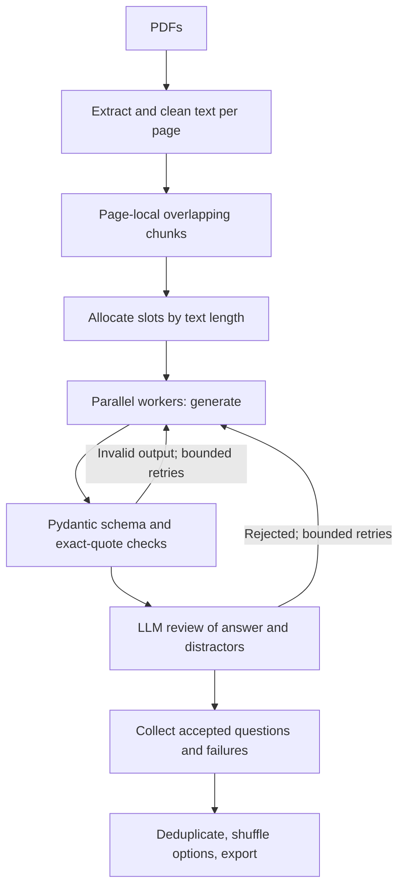

# MCQ Studio

Source-grounded multiple-choice quizzes from text-based PDFs, built with
LangGraph, Pydantic, and Gradio. Each accepted question includes four options,
one correct answer, an explanation, and a supporting quote with a page citation.

## Quickstart

Python 3.11+ is required. Run commands from the project root.

```sh
uv sync --frozen --extra dev
```

Copy `.env.example` to `.env` (PowerShell: `Copy-Item .env.example .env`),
unless `.env` already exists. Set your Hugging Face token with inference access:

```dotenv
LLM_PROVIDER=huggingface
LLM_MODEL=Qwen/Qwen2.5-72B-Instruct
HF_TOKEN=your-token
```

The default is a non-thinking instruction model; weights are not downloaded.
The model must be available through a hosted Hugging Face Inference Provider.
Availability, pricing, and permissions vary. Change `LLM_MODEL` if unavailable.

```sh
uv run python -m mcqgen.app serve
```

Open Gradio's printed URL (normally `http://127.0.0.1:7860`). Upload PDFs, select
count and difficulty, then generate. Select answers to check them, review their
citations, and download the quiz as JSON. Occupied local ports are skipped.

Without [uv](https://docs.astral.sh/uv/), create a virtual environment and run
`pip install -e ".[dev]"`. On Windows, use
`.venv\Scripts\python.exe -m mcqgen.app serve` if `mcqgen.exe` is blocked by the OS.

## CLI

```sh
uv run python -m mcqgen.app generate chapter.pdf -n 10 --difficulty medium -o quiz.json
```

Multiple PDF paths are supported. Difficulty is `easy`, `medium`, or `hard`.
JSON uses zero-based `answer_index` and one-based PDF page numbers, which may
differ from printed page numbers. Exports include source chunk text and warnings.
A partial quiz is a successful result with warnings; configuration errors exit
with a nonzero status.

## Architecture



Pydantic enforces response fields, four distinct options, and answer index, not
factual correctness. Quote matching and an LLM judge add grounding checks.
JSON wrapped in prose or code fences is accepted after discarding reasoning
blocks; malformed or incomplete JSON is rejected rather than guessed or repaired.

Two separate retry budgets apply:

- `MAX_RETRIES`: content regeneration after invalid output or judge rejection
  (default 2 retries after the initial generation).
- `REQUEST_ATTEMPTS`: total attempts per request for timeouts, connection errors,
  408/409/425/429, and common 5xx responses (default 3).

Requests use exponential backoff with jitter and respect numeric or HTTP-date
`Retry-After` headers. Delays are bounded to 30 seconds; a longer requested wait
omits that question and advises trying later instead of retrying too early.
Exhausted request retries do not restart the content loop; other jobs continue,
including when a judge request fails. HTTP 401/402/403/404 abort the run with
credential, billing, access, or model-availability guidance. OpenAI and Anthropic
SDK retries are disabled; other SDKs may retry internally.

## Providers

Set both `LLM_PROVIDER` and `LLM_MODEL`, then install the relevant extra:

| Backend | Provider value | Extra | Credential |
| --- | --- | --- | --- |
| Hugging Face hosted chat | `huggingface` | Included | `HF_TOKEN` |
| OpenAI | `openai` | `uv sync --extra openai` | `OPENAI_API_KEY` |
| Anthropic | `anthropic` | `uv sync --extra anthropic` | `ANTHROPIC_API_KEY` |
| Google Gemini | `google_genai` | `uv sync --extra google` | `GOOGLE_API_KEY` |
| Ollama | `ollama` | `uv sync --extra ollama` | Local server and model |

Set `JUDGE_PROVIDER` and `JUDGE_MODEL` for a separate reviewer. Without overrides,
the judge uses the same model/provider. Set both when switching provider families.
LangChain uses structured output where supported, otherwise JSON parsing.
Model-specific structured-output and hosting support are not guaranteed.

Other settings include `MAX_CONCURRENCY` (default 3 workers), `MODEL_TIMEOUT`
(default 90 seconds per request), `APP_HOST`, and `APP_PORT`. Multiple paid calls
can be made per question; monitor provider usage and start with a small quiz.

## Privacy And Deployment

Hosted providers receive source excerpts and questions. Only upload documents you
have permission to process. Credentials and PDFs are gitignored. Temporary Gradio
files and session state expire; there is no quiz database. Exports contain source
text, so treat them accordingly.

Tracing is disabled by default. Set `LANGSMITH_TRACING=true`, `LANGSMITH_API_KEY`,
and optionally `LANGSMITH_PROJECT` for graph traces. Traces include document and
quiz text. Direct Hugging Face calls are not separately instrumented as LLM spans.
Unexpected errors log tracebacks; upstream error details may be sensitive, so
review logs before sharing them.

The default server binds to localhost. Add authentication, quotas, and deployment
hardening before exposing it publicly.

## Docker

Create `.env` with credentials, then run:

```sh
docker compose up --build
```

The service binds to localhost port 7860 on the host, runs as a non-root user,
and installs from `uv.lock`. Secrets are supplied at runtime, not baked into the
image. Stop with `docker compose down`.

## Development

```sh
uv sync --frozen --extra dev
uv run pytest -q
uv run ruff check src/mcqgen tests
uv run ruff format --check src/mcqgen tests
uv run mypy src/mcqgen
```

Tests use fake models and local stubs without live inference or credentials.
CI runs these gates on Python 3.11 and 3.13. Tests do not certify model quality
or availability; live inference, LangSmith, and Docker need deployment-specific
verification.

```text
src/mcqgen/
  app.py         Gradio interface and CLI
  config.py      Environment settings
  graph.py       Workers, validation, and finalization
  ingestion.py   PDF extraction, cleaning, chunking
  llm.py         Model adapters, parsing, request retries
  schemas.py     Typed source, question, quiz models
  service.py     Ingestion-to-graph progress stream
tests/           Offline regression tests
```

## Limitations

- Text-based PDFs only: no OCR for scans or encrypted documents.
- Maximum 100 PDF pages across uploads and 25 MB per file.
- Each question uses one page-local chunk; no cross-page reasoning or RAG index.
- One difficulty level per quiz, not a mix.
- Headers/footers are filtered; exercise sections are not detected.
- Near-duplicates are dropped, not replaced. Requested counts are not guaranteed.
- LLM judges can still accept ambiguous or incorrect questions. Review quizzes
  before using them for assessment.

## License

MIT. Model/provider licenses and document rights remain separate.
